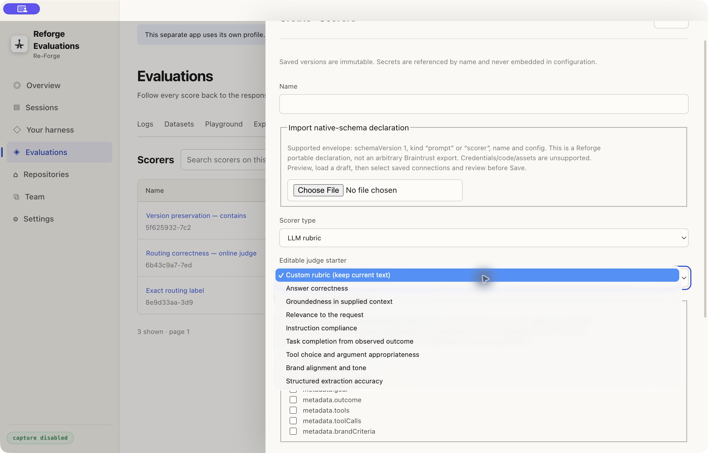
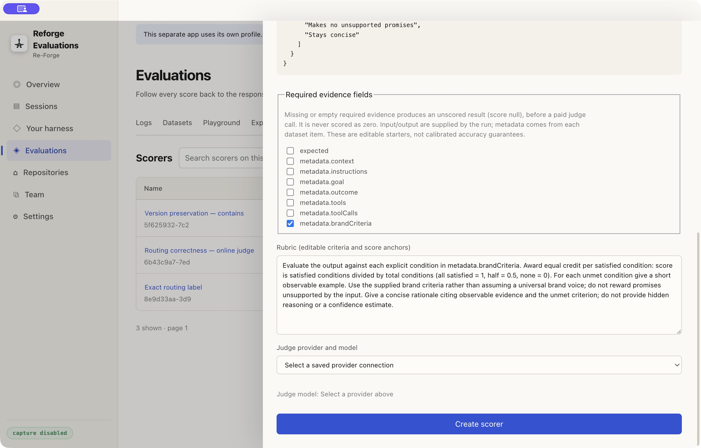

# How we improved Ava’s product recommendations

Ava sounded helpful, but recommended a product without establishing that it suited the shopper. TheAdaply helped us find the gap, test a fix, and compare the results.

## Meet Ava, our retail voice agent

Fantastic-Ava-3 helps shoppers compare products and place orders after confirmation. Her role: a helpful shopping assistant using catalog search, prices, and order tools.

> “I need one portable dehumidifier for a damp basement. My total budget is $1,000 before tax, and I can wait.”

Recorded test input · local demo, not a customer testimonial.

Ava recommended an outdoor-described product without qualifying basement suitability. Ten search results also didn’t establish a catalog-wide “cheapest” option.

### What changed in Ava’s answer

##### Before · unsupported fit

> “Cheapest within your budget by actual required purchase is the portable non-powered outdoor dehumidifier…”

##### After · suitability qualified

> “For a damp basement, note it’s described for small-space moisture control, not whole-basement powered drying.”

Recorded local eval · actual answer excerpts. The revised agent searched more broadly and explained the product’s limitation.

## Turn the failure into a test

In our evaluation app, we saved the conversation as a test and defined four checks: product fit, supported “cheapest” claims, minimum-order totals, and no unrequested order.

We added two instructions: verify suitability against product evidence; qualify claims when fit or comparison coverage is uncertain. Then we ran both versions on the same saved cases.

## Choose what the judge checks

Built-in rubric starters cover correctness, groundedness, relevance, instructions, task completion, tool use, brand/tone, and extraction. Edit the criteria for your agent—including conciseness or formal tone.

Actual app screenshot · eight editable starters. On mobile, swipe to read; open the image for the full view.

Actual app screenshot · criteria and score definitions, with evidence-backed explanations. This shows judge setup, not an Ava result.

## The result—and the trade-off

Independent answer and tool review, before and after the prompt change

| Reviewed outcomes | Before | After |
| --- | --- | --- |
| Development cases | 5 passed 1 partial | 6 passed |
| Held-out cases | 4 passed | 4 passed |
| Total tool calls | 11 | 20 |

Ten conversations, one run per version, cached catalog data, text/tool evaluation. Voice quality and production reliability weren’t tested. Running cost is unknown; savings aren’t established. Judge rationales contained errors, so these outcomes use independent AI-assisted answer/tool review, not the judge’s score increase.

## What we do for your team

Bring one workflow and sanitized example calls. We set up traces, build your dataset and checks, and deliver a baseline report plus a repeatable comparison for prompt, model, or tool changes. Review failures before shipping; add new production failures as regression tests.

[Bring us one agent workflow.](https://tally.so/r/lb4Rkp)

## Evidence notes

Recorded local evaluation, 13 November 2026. Ava baseline commit: `846bed4`; candidate: `50f72a6`. Both used gpt-5.5 with medium reasoning. The candidate changed two recommendation instructions. Six development and four disjoint held-out conversations were compared, with one run per version per case. Independent assistant review examined answers and tool evidence; these counts are not human-rater agreement or a general accuracy estimate.

Across ten pairs, summed API execution duration was 135.366 seconds before and 148.642 seconds after; tool calls were 11 and 20. Monetary cost was not established. The selected LLM-judge rationales contained errors, so their raw score increase is not used as evidence of improvement. The runs used cached catalog data and an isolated local evaluation service; they did not establish production reliability or voice quality.

The screenshots show the installed Reforge Evaluations app's editable rubric setup, captured 15 November 2026. They are not screenshots of the Ava comparison. Starter criteria are adapted from attributed Autoevals patterns, as shown in the app. Raw traces and customer identifiers are not included.
